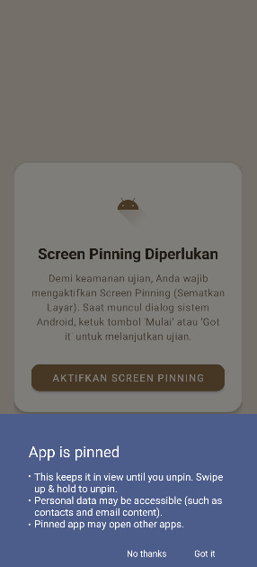
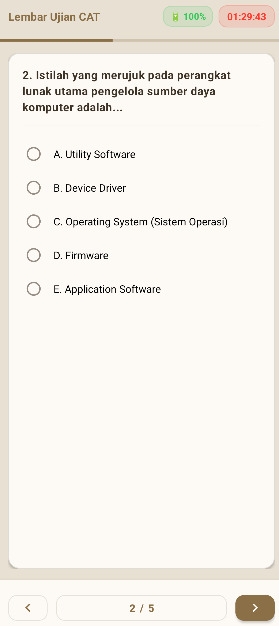

  

# PlayCAT

A simple app for CAT (Computer Assisted Test) available for Android and Linux (Arch), utilizing a teacher-based question bank instead of Google Forms. Built using [MoonBit](https://www.moonbitlang.com/) and [Kotlin](https://kotlinlang.org/), it features an integrated tokenizer, full gesture support, screen pinning, non-split screen mode, and robust security against deep debug access and mock locations. The UI uses a single sepia color scheme inspired by "Oyen," the orange cat notoriously known as the worst cat, and is based on the [Kartu Pelajar app](https://play.google.com/store/apps/details?id=moqbit.project.bahalap). While deliberately designed to be the most hated app by its users for educational purposes, it still maintains a simple and straightforward UI/UX to avoid confusion. This is a non-profit experimental project intended as a free, zero-cost tool (without any MBG and sawit fees).

### Preview

### Download

[Download PlayCAT here](https://github.com/manogamika/PlayCAT/releases/tag/build)
